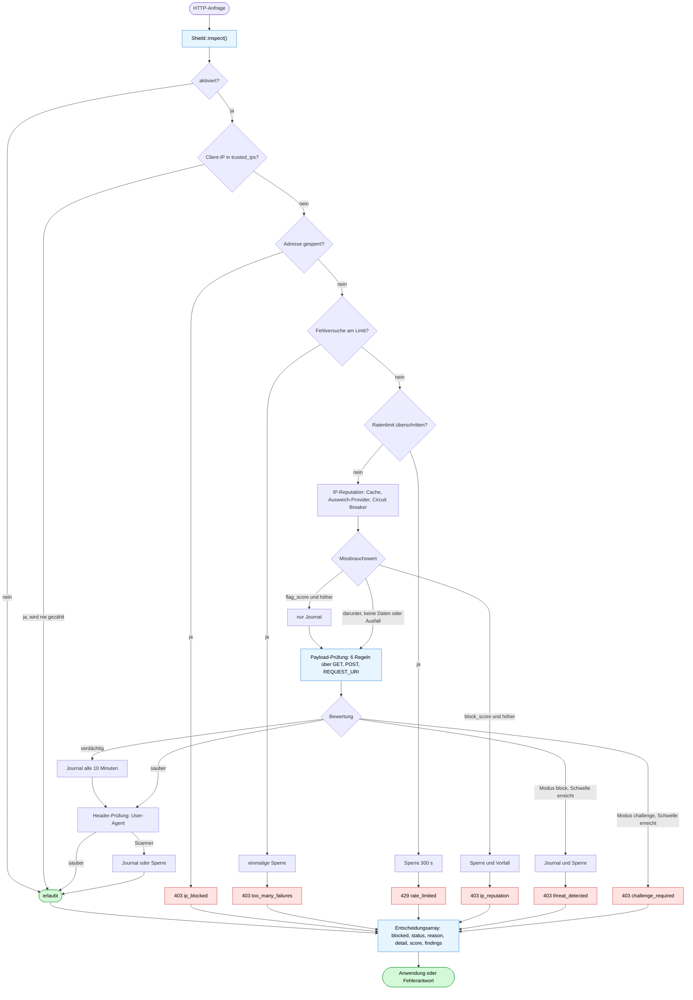

# PHP Shield

**Modulare Request-Firewall für PHP**: lokale Bedrohungserkennung, IPv4/IPv6-Reputation (AbuseIPDB.com und AbuseIPDB.ru), Ratenbegrenzung, IP-Sperren mit schweregradabhängiger Dauer, ein Vorfalljournal und ein Admin-Dashboard.

[English](README.md) · [Русский](README.ru.md) · **Deutsch** · [Español](README.es.md) · [中文](README.zh.md) · [हिन्दी](README.hi.md)

[](https://github.com/paulmann/PHP-Shield/actions)
[](https://php.net)
[](phpstan.neon)
[](tests)
[](LICENSE)
[](https://github.com/paulmann/PHP-Shield/wiki)

## Inhalt

- [Was das Shield leistet](#was-das-shield-leistet)
- [Wie über eine Anfrage entschieden wird](#wie-über-eine-anfrage-entschieden-wird)
- [Voraussetzungen](#voraussetzungen)
- [Installation](#installation)
- [Schnellstart](#schnellstart)
- [Das Entscheidungsarray](#das-entscheidungsarray)
- [IP-Reputation: AbuseIPDB.com und AbuseIPDB.ru](#ip-reputation-abuseipdbcom-und-abuseipdbru)
- [Erkennungsregeln](#erkennungsregeln)
- [Modi und Sperrdauern](#modi-und-sperrdauern)
- [Ratenbegrenzung](#ratenbegrenzung)
- [State-API](#state-api)
- [Admin-Dashboard](#admin-dashboard)
- [Reverse-Proxys und Client-IP](#reverse-proxys-und-client-ip)
- [Architektur](#architektur)
- [Tests](#tests)
- [Checkliste für den Produktivbetrieb](#checkliste-für-den-produktivbetrieb)
- [Dokumentation](#dokumentation)
- [Mitwirken](#mitwirken)
- [Lizenz](#lizenz)
- [Danksagung](#danksagung)

## Was das Shield leistet

Ein einziger Einstiegspunkt, `Deynekin\PhpShield\Middleware\Shield::inspect()`, beantwortet eine einzige Frage: **Darf diese Anfrage weiterlaufen, und wenn nicht, warum?**

Er kombiniert vier Schichten:

| Schicht | Klasse | Aufgabe |
|---|---|---|
| Entscheidung | `Middleware\Shield` | Ratenlimits, Prüfung von Payload und Headern, IP-Reputation, das Urteil |
| Zustand | `Middleware\SecurityMiddleware` | Sperren, Vorfalljournal, Zähler für Fehlversuche, Bereinigung, Statistiken |
| Erkennung | `Detection\*` | austauschbare Regeln, die einen Payload bewerten |
| Wissen | `ThreatIntel\*` | Reputation aus AbuseIPDB.com / AbuseIPDB.ru mit Cache und Circuit Breaker |

Zwei Regeln bestimmen jede Entscheidung:

- **Ein einzelner Fund sperrt niemanden.** Die Punkte summieren sich, und erst eine Summe oberhalb von `block_threshold` führt zur Sperre. Über eine dauerhafte Sperre entscheidet ein Operator, nicht ein regulärer Ausdruck.
- **Bei Infrastrukturproblemen wird nichts geschlossen (kein „fail closed").** Ein Ausfall von Datenbank oder API bedeutet „keine Daten", nicht „ablehnen" — siehe [ADR-006](docs/adr.md).

Was das Shield **nicht** ist: ein Ersatz für Prepared Statements, Ausgabe-Escaping, CSP, Authentifizierung oder Session-Sicherheit. Es verschafft Zeit und Sichtbarkeit; Fehler in der Anwendung behebt es nicht.

## Wie über eine Anfrage entschieden wird

`inspect()` durchläuft die Schichten in fester Reihenfolge: billige Prüfungen zuerst, das Netzwerk zuletzt, und eine vertrauenswürdige Adresse verlässt den Pfad, bevor Arbeit entsteht. Jeder Zweig endet im selben Entscheidungsarray: `blocked`, `status`, `reason`, `detail`, `score` und `findings`.



Die Modus-Zweige stehen neben der Bewertung, nicht am Anfang: `monitor` und `challenge` ändern die Reaktion auf einen Fund, nicht die Reihenfolge der Prüfungen.

## Voraussetzungen

- PHP 8.1 – 8.5, `ext-json`, `ext-mbstring`
- Optional: `ext-mysqli` (MySQL-Speicher, Admin), `ext-redis` (Redis-Ratenbegrenzer), `ext-curl` (IP-Reputation)

## Installation

```bash
composer require paulmann/php-shield
```

## Schnellstart

```php
<?php
require 'vendor/autoload.php';

use Deynekin\PhpShield\ShieldFactory;

$config = require 'vendor/paulmann/php-shield/config/default.php';
$config['mode'] = 'monitor';              // start safe, switch to "block" after tuning

$mysqli = new mysqli('127.0.0.1', 'user', 'pass', 'dbname');
$shield = ShieldFactory::create($config, $mysqli);

$decision = $shield->inspect(array_merge($_GET, $_POST), $_SERVER, $_SERVER['REQUEST_URI'] ?? '/');

if ($decision['blocked']) {
    http_response_code($decision['status']);
    header('Content-Type: application/json');
    exit(json_encode(['error' => $decision['reason'], 'detail' => $decision['detail']]));
}

// Application logic continues...
```

Kein MySQL? Bauen Sie das Shield stattdessen aus Komponenten zusammen — lokale Erkennung, Header und Statistiken funktionieren weiterhin:

```php
$shield = ShieldFactory::createWithComponents(
    $blockStore,                                  // your BlockStoreInterface implementation
    new \Deynekin\PhpShield\RateLimiting\RedisRateLimiter($redis),
    $config
);
```

## Das Entscheidungsarray

`inspect()` liefert:

```php
[
    'blocked'  => true,                 // may the request proceed?
    'status'   => 403,                  // HTTP status to send
    'reason'   => 'threat_detected',    // machine-readable code
    'detail'   => '...',                // human-readable text
    'score'    => 90,                   // accumulated score
    'findings' => ['xss', 'sql_injection'],
]
```

Gründe: `ip_blocked`, `too_many_failures`, `rate_limited`, `ip_reputation`, `threat_detected`, `challenge_required`, `suspicious_user_agent`.

Die Reihenfolge der Prüfungen ist fest und bewusst gewählt: Hauptschalter → vertrauenswürdige Adresse (wird nie gesperrt, nie gezählt) → aktive Sperre → Zähler für Fehlversuche → Ratenlimits → IP-Reputation → Payload-Prüfung → Header-Prüfung → Freigabe.

Wenn Sie lediglich einen booleschen Wert benötigen, rufen Sie `isRequestAllowed()` mit denselben Argumenten auf.

# README i18n de/es/zh/hi/ru — run 78725121 participant 0

## IP reputation: AbuseIPDB.com and AbuseIPDB.ru

Beide Dienste implementieren denselben API-v2-Vertrag (`/check`, `Key:`-Header, identische Envelopes), daher bedient ein Client beide, und der Checker probiert sie der Reihe nach aus.

Die Reputationsebene ist **standardmäßig asynchron**: Eine Anfrage wartet nie auf AbuseIPDB. Eine bekannte Adresse wird aus dem Cache beantwortet, eine unbekannte mit einem einzigen `INSERT` in die Warteschlange gestellt, und der Worker füllt den Cache außerhalb des Anforderungspfades. Wechseln Sie nur bei Endpunkten mit geringem Verkehr, bei Tests oder CLI-Werkzeugen zu `'mode' => 'sync'`.

| Modus | Anforderungspfad | Wann das Urteil greift |
|---|---|---|
| `async` (Standard) | Cache-Lesevorgang plus höchstens ein `INSERT` in `php_shield_reputation_queue` | ab der nächsten Anfrage, nachdem der Worker die Antwort gespeichert hat |
| `sync` | ein HTTP-Aufruf, begrenzt durch `timeout` | sofort |

```bash
# cron: fill the reputation cache every minute
* * * * * php /path/to/PHP-Shield/tools/reputation-worker.php >> /var/log/php-shield-reputation.log 2>&1

php tools/reputation-worker.php --status         # queue size and providers
php tools/reputation-worker.php --ip=8.8.8.8     # one address now (debugging)
```

```php
$config['ip_reputation'] = [
    'enabled' => true,
    'block_score' => 75,   // abuseConfidenceScore that blocks
    'flag_score' => 25,    // score that is only journaled
    'cache_ttl' => 86400,
    'max_age_days' => 90,
    'timeout' => 2,        // sync mode only
    'queue_batch' => 50,   // addresses claimed per worker run
    'per_run' => 100,      // lookups per worker run (quota guard)
    'retry_after' => 300,  // retry delay after a failed lookup
    'providers' => [
        ['name' => 'abuseipdb.com', 'base_url' => 'https://api.abuseipdb.com/api/v2',
         'api_key' => null, 'api_key_env' => 'ABUSEIPDB_API_KEY'],
        ['name' => 'abuseipdb.ru',  'base_url' => 'https://abuseipdb.ru/api/v2',
         'api_key' => null, 'api_key_env' => 'ABUSEIPDB_RU_API_KEY'],
    ],
];
```

```bash
export ABUSEIPDB_API_KEY=[redacted]          # or put the key in the config, never in git
php tools/live-abuseipdb.php 8.8.8.8
```

Verhalten, das in der Produktion zählt:

- Antworten werden für `cache_ttl` Sekunden zwischengespeichert — ein Burst kostet eine Abfrage, und es wird ausschließlich zu öffentlichen Adressen angefragt;
- der Worker beachtet `per_run`, sodass das Tageskontingent schrittweise statt in einem einzigen Schub verbraucht wird;
- eine fehlgeschlagene Abfrage bleibt mit `retry_after`-Backoff in der Warteschlange — ein API-Ausfall kann den Worker nicht in eine Endlosschleife treiben;
- der Erstbesuch einer neuen Adresse wird nie verzögert und nie *wegen* AbuseIPDB blockiert: Die Reputationsebene bestätigt oder entlastet ihn bei einer folgenden Anfrage (ADR-010);
- der erste Provider, der antwortet, gewinnt; schlägt er fehl, wird der nächste versucht;
- `429` wird nie im laufenden Prozess wiederholt: Das angegebene Zeitfenster wird für alle folgenden Abfragen eingehalten;
- nach `circuit_breaker.failures` aufeinanderfolgenden Fehlern wird ein Provider für `cooldown` Sekunden übersprungen;
- eine `null`-Antwort, ein Timeout oder ein Kontingentfehler blockiert nie eine Anfrage;
- im `monitor`-Modus wird ein hoher Score protokolliert, aber nicht blockiert.

## Erkennungsregeln

| Regel | Kategorie | Score | Hinweise |
|---|---|---|---|
| `sql_injection` | injection | 25–80 | `UNION SELECT`, gestapelte Abfragen, `SLEEP`, Tautologien |
| `xss` | xss | 40–90 | script-/iframe-/object-Tags, Event-Handler, `javascript:` |
| `command_injection` | injection | 60–85 | die `system()`-Familie, Pipes auf Befehle, Backticks in Befehlen |
| `path_traversal` | path | 60–95 | wiederholte `../`, `/etc/passwd`, `.ssh`, `/proc/self` |
| `file_inclusion` | inclusion | 60–85 | Remote-Includes, `php://`-Wrapper |
| `suspicious_header` | headers | 60–70 | Scanner-User-Agents (sqlmap, nikto, nmap, …) |

Werte werden sowohl im Rohzustand als auch nach der URL-Dekodierung geprüft, zusätzlich die rohe `REQUEST_URI`, sodass `%3Cscript%3E` erkannt wird. Pro Regel und Feld wird nur ein Fund erfasst, damit ein doppelt kodierter Payload seinen Score nicht aufblähen kann.

### Eigene Regeln

```php
use Deynekin\PhpShield\Detection\AbstractRule;
use Deynekin\PhpShield\Detection\RuleFactory;

final class MyRule extends AbstractRule
{
    public function getName(): string { return 'my_rule'; }
    public function getCategory(): string { return 'custom'; }

    public function check(string $value, string $fieldName): array
    {
        return $this->match('/evil/i', $value, $fieldName, 45, 'Custom evil pattern');
    }
}

RuleFactory::register('my_rule', MyRule::class);
```

## Modi und Sperrdauern

| Modus | Verhalten |
|---|---|
| `monitor` | alles wird protokolliert, nichts wird gesperrt |
| `challenge` | harte Funde werden mit 403 `challenge_required` abgewiesen und nicht gesperrt |
| `block` | harte Funde sperren die Adresse für eine aus dem Schweregrad abgeleitete Dauer |

Dauer = `block_duration` × `severity_block_multipliers`:

| Schweregrad | Multiplikator | Standarddauer |
|---|---|---|
| `low` | 0.5 | 30 Min. |
| `medium` | 1 | 1 Std. |
| `high` | 4 | 4 Std. |
| `critical` | 12 | 12 Std. |

Die Ratenbegrenzung hat ihr eigenes kurzes Zeitfenster (`rate_limit_block_duration`, 300 s), damit eine Lastspitze von einer gemeinsam genutzten Adresse (Shared/NAT) nicht ein ganzes Büro aussperrt. Eine dauerhafte Sperre erfolgt nie automatisch: Sie ist eine Operator-Aktion im Dashboard oder über `blockPermanently()`.

## Ratenbegrenzung

| Backend | Zählweise | Einsatzfall |
|---|---|---|
| `DatabaseRateLimiter` | zwei Anweisungen (count, insert) auf `php_shield_rate_limit` | geringer und mittlerer Datenverkehr; rufen Sie `prune()` regelmäßig auf |
| `RedisRateLimiter` | atomares `INCR` + `EXPIRE` | gleichzeitiger Datenverkehr; schlägt bei Ausfall offen fehl (fail open) und protokolliert, wenn Redis nicht erreichbar ist |

Die Standardlimits liegen bei 60/Minute, 1 000/Stunde und 10 000/Tag pro Adresse und Endpunkt. Beide Backends implementieren `RateLimiterInterface`, sodass sich ein vorhandener Limiter einbinden lässt.

## State-API

```php
$state = $shield->middleware();

$state->isIpBlocked('203.0.113.5');
$state->blockIp('203.0.113.5', 'scanner', SecurityMiddleware::SEVERITY_HIGH);
$state->blockPermanently('203.0.113.5', 'manual decision');   // operator only
$state->unblockIp('203.0.113.5');

$state->recordFailedAttempt('203.0.113.5');   // e.g. from your login handler
$state->failedAttempts('203.0.113.5');
$state->clearFailedAttempts('203.0.113.5');

$state->recordIncident('203.0.113.5', 'login_bruteforce', 'Ten failed logins', 'high');
$state->recentIncidentCount('203.0.113.5', 600);
$state->activeBlocks(50);
$state->stats();
$state->cleanup(30);        // retention: expired blocks, old incidents, stale counters
```

Wenn ein Zähler für Fehlversuche `max_failed_attempts` (25) erreicht, wird die nächste Anfrage von dieser Adresse einmalig gesperrt und der Zähler zurückgesetzt.

Tabellen: `php_shield_ip_blocks`, `php_shield_incidents`, `php_shield_failed_attempts`, `php_shield_rate_limit`, `php_shield_ip_reputation`. Alle Ablaufzeiten werden von der Datenbank berechnet (`NOW()`, `DATE_ADD`), sodass eine Zeitzonendifferenz zwischen PHP und MySQL eine frische Sperre nicht ablaufen lässt.

## Admin-Dashboard

`public/admin/index.php` — Statistiken, aktive Sperren, manuelles Sperren und Entsperren, maskierte Konfiguration.

- jedes zustandsändernde Formular trägt ein sitzungsgebundenes Anti-CSRF-Token;
- die Anmeldung ist ratenbegrenzt (5 Fehlversuche → 5 Min. Sperre), die Session-ID wird bei der Anmeldung neu erzeugt;
- das Session-Cookie ist `HttpOnly`, `SameSite=Strict`, bei HTTPS zusätzlich `Secure`;
- der Konfigurationsdump maskiert Passwörter, Tokens und Schlüssel, bevor er ausgegeben wird.

Erzeugen Sie einen Hash und schützen Sie den Endpunkt zusätzlich auf Webserver-Ebene:

```bash
php -r "echo password_hash('your-secret', PASSWORD_DEFAULT), PHP_EOL;"
```

## Reverse-Proxys und Client-IP

`X-Forwarded-For` wird nur berücksichtigt, wenn `REMOTE_ADDR` in `trusted_proxies` steht, und die Kette wird **von rechts nach links** gelesen, wobei vertrauenswürdige Hops übersprungen werden:

```text
X-Forwarded-For: 1.2.3.4, 203.0.113.9      (client-supplied, added by nginx)
REMOTE_ADDR:     10.0.0.5                  (trusted proxy)
→ client = 203.0.113.9
```

Würde stattdessen der linkeste Eintrag gelesen, könnte jeder Client seine eigene Adresse bestimmen — und mit einem passenden Eintrag in `trusted_ips` das gesamte Shield umgehen. Das war ein realer Defekt; er wurde in 2.0.0 behoben und im [Security Review](docs/security-review.md) dokumentiert.

## Architektur

```text
src/
├── ShieldFactory.php              ← wiring from configuration
├── Middleware/
│   ├── Shield.php                 ← decision: inspect() / isRequestAllowed()
│   └── SecurityMiddleware.php     ← state: blocks, incidents, counters, cleanup
├── Detection/                     ← rules + registry
├── ThreatIntel/                   ← AbuseIPDB.com / .ru, cache, circuit breaker
├── Ip/                            ← safe client IP resolution, CIDR
├── RateLimiting/                  ← database + Redis limiters
├── Storage/                       ← block store interfaces + MySQL
├── Admin/                         ← dashboard logic, sessions, CSRF
├── Support/                       ← typed config, redaction, headers
└── Exception/
```

Designentscheidungen, verworfene Alternativen und ihre Konsequenzen sind in [docs/adr.md](docs/adr.md) festgehalten.

## Tests

```bash
composer test          # PHPUnit, 120 tests, no database needed
composer phpstan       # level max, zero errors
composer cs-check      # coding standard

# real MySQL (creates its own tables, never drops a database)
MYSQL_PWD=... php -d extension=mysqli tools/db-selftest.php php_shield_test

# live AbuseIPDB check (key from the environment)
ABUSEIPDB_API_KEY=[redacted] php tools/live-abuseipdb.php 8.8.8.8
```

Die CI führt PHP 8.1 – 8.5, PHPUnit, PHPStan auf Stufe max, den Coding Standard und eine Syntaxprüfung jeder PHP-Datei aus.

## Checkliste für den Produktivbetrieb

1. Lassen Sie das Shield einige Tage im Modus `monitor` laufen.
2. Lesen Sie `php_shield_incidents` und justieren Sie `block_threshold` nach beziehungsweise deaktivieren Sie zu laute Regeln.
3. Spielen Sie `migrations/schema.sql` ein und setzen Sie `auto_migrate` auf `false`.
4. Stellen Sie den Ratenbegrenzer für gleichzeitigen Datenverkehr auf Redis um.
5. Füllen Sie `trusted_proxies`, wenn Sie hinter einem Reverse-Proxy laufen — Forwarded-Header werden **nur** von diesen Adressen berücksichtigt, und die Kette wird von rechts nach links gelesen.
6. Schützen Sie das Admin-Dashboard und setzen Sie einen starken Passwort-Hash.
7. Planen Sie `cleanup()` (Aufbewahrung) und `DatabaseRateLimiter::prune()` ein.
8. Aktivieren Sie `ip_reputation` mit AbuseIPDB.com und halten Sie AbuseIPDB.ru als Rückfallebene bereit.
9. Rufen Sie `SecurityHeaders::send()` früh im Request auf.
10. Wechseln Sie in den Modus `block` und beobachten Sie einen Tag lang die Rate der 403/429-Antworten.

## Dokumentation

- [Wiki](https://github.com/paulmann/PHP-Shield/wiki) — Konfigurationsreferenz, Rezepte, Fehlerbehebung, Upgrade-Anleitung
- [Architecture Decision Records](docs/adr.md)
- [Security Review](docs/security-review.md) — Feststellungen und ihre Behebungen
- [Referenz-Adapter](integration/abuseipdb-ru/README.md) — eine handgeschriebene AbuseIPDB.RU-Middleware durch dieses Paket ersetzen
- [SECURITY.md](SECURITY.md) — wie Sie eine Schwachstelle melden
- [AGENTS.md](AGENTS.md) — Anweisungen für KI-Coding-Agenten

## Mitwirken

Lesen Sie zuerst [CONTRIBUTING.md](CONTRIBUTING.md): Coding Standard, statische Analyse, Tests und die Review-Checkliste. Issues und Pull Requests sind willkommen; Sicherheitsmeldungen laufen über [SECURITY.md](SECURITY.md).

## Lizenz

MIT — siehe [LICENSE](LICENSE).

## Danksagung

Entwickelt von Mikhail Deynekin. Die Schweregrad-Richtlinie und die Trennung von Zustand und Erkennung wurden durch die eigenständige Middleware auf AbuseIPDB.RU und durch die WAF des PHP-Form-Spam-Checker geprägt.

---

[English](README.md) · [Русский](README.ru.md) · **Deutsch** · [Español](README.es.md) · [中文](README.zh.md) · [हिन्दी](README.hi.md)
