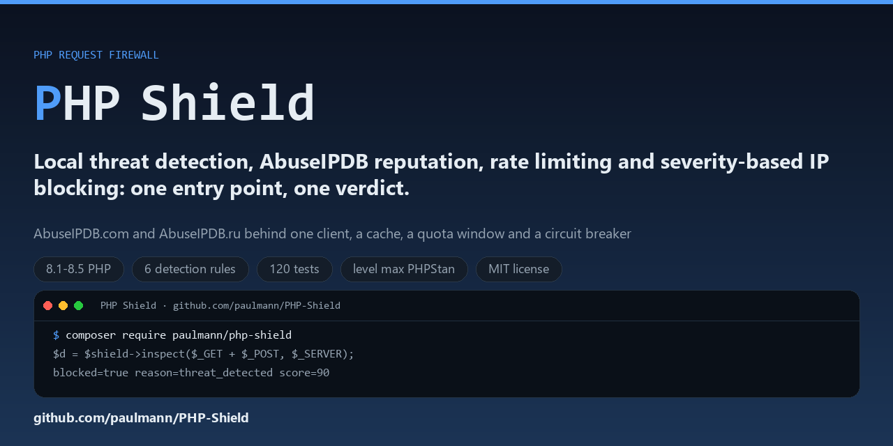

# PHP Shield

**Firewall modular de solicitudes para PHP**: detección local de amenazas, reputación de IPv4/IPv6 (AbuseIPDB.com y AbuseIPDB.ru), limitación de tasa, bloqueo de IP con duraciones según la severidad, una bitácora de incidentes y un panel de administración.

[English](README.md) · [Русский](README.ru.md) · [Deutsch](README.de.md) · **Español** · [中文](README.zh.md) · [हिन्दी](README.hi.md)

[](https://github.com/paulmann/PHP-Shield/actions)
[](https://php.net)
[](phpstan.neon)
[](tests)
[](LICENSE)
[](https://github.com/paulmann/PHP-Shield/wiki)

## Índice

- [Qué hace](#qué-hace)
- [Requisitos](#requisitos)
- [Instalación](#instalación)
- [Inicio rápido](#inicio-rápido)
- [El array de decisión](#el-array-de-decisión)
- [Reputación de IP: AbuseIPDB.com y AbuseIPDB.ru](#reputación-de-ip-abuseipdbcom-y-abuseipdbru)
- [Reglas de detección](#reglas-de-detección)
- [Modos y duración de los bloqueos](#modos-y-duración-de-los-bloqueos)
- [Limitación de tasa](#limitación-de-tasa)
- [API de estado](#api-de-estado)
- [Panel de administración](#panel-de-administración)
- [Proxies inversos e IP del cliente](#proxies-inversos-e-ip-del-cliente)
- [Arquitectura](#arquitectura)
- [Pruebas](#pruebas)
- [Lista de verificación para producción](#lista-de-verificación-para-producción)
- [Documentación](#documentación)
- [Contribución](#contribución)
- [Licencia](#licencia)
- [Créditos](#créditos)

## Qué hace

Un único punto de entrada, `Deynekin\PhpShield\Middleware\Shield::inspect()`, responde a una sola pregunta: **¿puede continuar esta solicitud y, si no, por qué?**

Combina cuatro capas:

| Capa | Clase | Responsabilidad |
|---|---|---|
| Decisión | `Middleware\Shield` | límites de tasa, escaneo de payload y encabezados, reputación de IP, el veredicto |
| Estado | `Middleware\SecurityMiddleware` | bloqueos, bitácora de incidentes, contadores de intentos fallidos, limpieza, estadísticas |
| Detección | `Detection\*` | reglas conectables que puntúan un payload |
| Conocimiento | `ThreatIntel\*` | reputación de AbuseIPDB.com / AbuseIPDB.ru con caché y circuit breaker |

Dos reglas condicionan cada decisión:

- **Un solo hallazgo nunca bloquea a nadie.** Las puntuaciones se acumulan y solo un total superior a `block_threshold` bloquea. Es un operador, no una expresión regular, quien decide un bloqueo permanente.
- **Nada falla en cerrado ante problemas de infraestructura.** Una caída de la base de datos o de la API significa «sin datos», no «denegar»; véase [ADR-006](docs/adr.md).

Lo que el shield **no** es: un sustituto de las consultas preparadas, el escape de salida, la CSP, la autenticación o la seguridad de sesiones. Gana tiempo y visibilidad; no corrige los defectos de la aplicación.

## Requisitos

- PHP 8.1 – 8.5, `ext-json`, `ext-mbstring`
- Opcional: `ext-mysqli` (almacenamiento MySQL, administración), `ext-redis` (limitador de tasa Redis), `ext-curl` (reputación de IP)

## Instalación

```bash
composer require paulmann/php-shield
```

## Inicio rápido

```php
<?php
require 'vendor/autoload.php';

use Deynekin\PhpShield\ShieldFactory;

$config = require 'vendor/paulmann/php-shield/config/default.php';
$config['mode'] = 'monitor';              // start safe, switch to "block" after tuning

$mysqli = new mysqli('127.0.0.1', 'user', 'pass', 'dbname');
$shield = ShieldFactory::create($config, $mysqli);

$decision = $shield->inspect(array_merge($_GET, $_POST), $_SERVER, $_SERVER['REQUEST_URI'] ?? '/');

if ($decision['blocked']) {
    http_response_code($decision['status']);
    header('Content-Type: application/json');
    exit(json_encode(['error' => $decision['reason'], 'detail' => $decision['detail']]));
}

// Application logic continues...
```

¿No hay MySQL? En su lugar, construye el shield a partir de componentes: la detección local, los encabezados y las estadísticas siguen funcionando:

```php
$shield = ShieldFactory::createWithComponents(
    $blockStore,                                  // your BlockStoreInterface implementation
    new \Deynekin\PhpShield\RateLimiting\RedisRateLimiter($redis),
    $config
);
```

## El array de decisión

`inspect()` devuelve:

```php
[
    'blocked'  => true,                 // may the request proceed?
    'status'   => 403,                  // HTTP status to send
    'reason'   => 'threat_detected',    // machine-readable code
    'detail'   => '...',                // human-readable text
    'score'    => 90,                   // accumulated score
    'findings' => ['xss', 'sql_injection'],
]
```

Motivos: `ip_blocked`, `too_many_failures`, `rate_limited`, `ip_reputation`, `threat_detected`, `challenge_required`, `suspicious_user_agent`.

El orden de las comprobaciones es fijo e intencional: interruptor maestro → dirección de confianza (nunca bloqueada, nunca contabilizada) → bloqueo activo → contador de intentos fallidos → límites de tasa → reputación de IP → escaneo del payload → escaneo de encabezados → permitir.

Si solo se necesita un valor booleano, basta con llamar a `isRequestAllowed()` con los mismos argumentos.

## Reputación de IP: AbuseIPDB.com y AbuseIPDB.ru

Ambos servicios implementan el mismo contrato de API v2 (`/check`, encabezado `Key:`, envoltorios idénticos), así que un solo cliente sirve para los dos y el verificador los prueba en orden.

```php
$config['ip_reputation'] = [
    'enabled' => true,
    'block_score' => 75,   // abuseConfidenceScore that blocks
    'flag_score' => 25,    // score that is only journaled
    'cache_ttl' => 86400,
    'timeout' => 2,
    'providers' => [
        ['name' => 'abuseipdb.com', 'base_url' => 'https://api.abuseipdb.com/api/v2',
         'api_key' => null, 'api_key_env' => 'ABUSEIPDB_API_KEY'],
        ['name' => 'abuseipdb.ru',  'base_url' => 'https://abuseipdb.ru/api/v2',
         'api_key' => null, 'api_key_env' => 'ABUSEIPDB_RU_API_KEY'],
    ],
];
```

```bash
export ABUSEIPDB_API_KEY=[redacted]          # or put the key in the config, never in git
php tools/live-abuseipdb.php 8.8.8.8
```

Comportamiento que importa en producción:

- las respuestas se guardan en caché durante `cache_ttl` segundos: una ráfaga cuesta una sola consulta y únicamente se consultan direcciones públicas;
- gana el primer proveedor que responde; si falla, se prueba el siguiente;
- `429` nunca se reintenta dentro del proceso: la ventana anunciada se respeta para todas las consultas posteriores;
- tras `circuit_breaker.failures` errores consecutivos, un proveedor se omite durante `cooldown` segundos;
- una respuesta `null`, un tiempo de espera agotado o un error de cuota nunca bloquean una solicitud;
- en modo `monitor`, una puntuación alta se registra pero no se bloquea.

## Reglas de detección

| Regla | Categoría | Puntuación | Notas |
|---|---|---|---|
| `sql_injection` | inyección | 25–80 | `UNION SELECT`, consultas apiladas, `SLEEP`, tautologías |
| `xss` | xss | 40–90 | etiquetas script/iframe/object, manejadores de eventos, `javascript:` |
| `command_injection` | inyección | 60–85 | familia `system()`, tuberías hacia comandos, acentos graves de comandos |
| `path_traversal` | ruta | 60–95 | `../` repetidos, `/etc/passwd`, `.ssh`, `/proc/self` |
| `file_inclusion` | inclusión | 60–85 | inclusiones remotas, envoltorios `php://` |
| `suspicious_header` | encabezados | 60–70 | User-Agents de escáneres (sqlmap, nikto, nmap, …) |

Los valores se escanean tal como se reciben y después de la decodificación de URL, además del `REQUEST_URI` sin procesar, de modo que `%3Cscript%3E` se detecta. Se registra un hallazgo por regla y por campo, así que un payload con doble codificación no puede inflar su puntuación.

### Reglas personalizadas

```php
use Deynekin\PhpShield\Detection\AbstractRule;
use Deynekin\PhpShield\Detection\RuleFactory;

final class MyRule extends AbstractRule
{
    public function getName(): string { return 'my_rule'; }
    public function getCategory(): string { return 'custom'; }

    public function check(string $value, string $fieldName): array
    {
        return $this->match('/evil/i', $value, $fieldName, 45, 'Custom evil pattern');
    }
}

RuleFactory::register('my_rule', MyRule::class);
```

## Modos y duración de los bloqueos

| Modo | Comportamiento |
|---|---|
| `monitor` | todo se registra, nada se bloquea |
| `challenge` | los hallazgos graves se rechazan con 403 `challenge_required` y no se bloquean |
| `block` | los hallazgos graves bloquean la dirección durante una duración derivada de la severidad |

Duración = `block_duration` × `severity_block_multipliers`:

| Severidad | Multiplicador | Duración predeterminada |
|---|---|---|
| `low` | 0.5 | 30 min |
| `medium` | 1 | 1 h |
| `high` | 4 | 4 h |
| `critical` | 12 | 12 h |

La limitación de tasa tiene su propia ventana corta (`rate_limit_block_duration`, 300 s) para que una ráfaga procedente de una dirección compartida o NAT no deje fuera a una oficina entera. Un bloqueo permanente nunca es automático: es una acción del operador en el panel o mediante `blockPermanently()`.

## Limitación de tasa

| Backend | Cómo cuenta | Cuándo usarlo |
|---|---|---|
| `DatabaseRateLimiter` | dos sentencias (contar, insertar) sobre `php_shield_rate_limit` | tráfico bajo y medio; llamar a `prune()` según una programación |
| `RedisRateLimiter` | `INCR` + `EXPIRE` atómicos | tráfico concurrente; falla en abierto y deja constancia si Redis no está disponible |

Los límites predeterminados son 60/minuto, 1 000/hora y 10 000/día por dirección y endpoint. Ambos backends implementan `RateLimiterInterface`, así que se puede conectar un limitador existente.

## API de estado

```php
$state = $shield->middleware();

$state->isIpBlocked('203.0.113.5');
$state->blockIp('203.0.113.5', 'scanner', SecurityMiddleware::SEVERITY_HIGH);
$state->blockPermanently('203.0.113.5', 'manual decision');   // operator only
$state->unblockIp('203.0.113.5');

$state->recordFailedAttempt('203.0.113.5');   // e.g. from your login handler
$state->failedAttempts('203.0.113.5');
$state->clearFailedAttempts('203.0.113.5');

$state->recordIncident('203.0.113.5', 'login_bruteforce', 'Ten failed logins', 'high');
$state->recentIncidentCount('203.0.113.5', 600);
$state->activeBlocks(50);
$state->stats();
$state->cleanup(30);        // retention: expired blocks, old incidents, stale counters
```

Cuando un contador de intentos fallidos alcanza `max_failed_attempts` (25), la siguiente solicitud desde esa dirección se bloquea una vez y el contador se restablece.

Tablas: `php_shield_ip_blocks`, `php_shield_incidents`, `php_shield_failed_attempts`, `php_shield_rate_limit`, `php_shield_ip_reputation`. Todas las expiraciones las calcula la base de datos (`NOW()`, `DATE_ADD`), de modo que una diferencia de zona horaria entre PHP y MySQL no puede hacer expirar un bloqueo recién creado.

## Panel de administración

`public/admin/index.php` — estadísticas, bloqueos activos, bloqueo y desbloqueo manuales, configuración enmascarada.

- cada formulario que modifica el estado lleva un token anti-CSRF por sesión;
- el inicio de sesión está limitado por tasa (5 fallos → 5 min de bloqueo) y el id de sesión se regenera al iniciar sesión;
- la cookie de sesión es `HttpOnly`, `SameSite=Strict`, `Secure` en HTTPS;
- el volcado de la configuración enmascara contraseñas, tokens y claves antes de renderizarse.

Genere un hash y proteja también el endpoint a nivel del servidor web:

```bash
php -r "echo password_hash('your-secret', PASSWORD_DEFAULT), PHP_EOL;"
```

## Proxies inversos e IP del cliente

`X-Forwarded-For` se respeta solo cuando `REMOTE_ADDR` está en `trusted_proxies`, y la cadena se lee **de derecha a izquierda**, omitiendo los saltos de confianza:

```text
X-Forwarded-For: 1.2.3.4, 203.0.113.9      (client-supplied, added by nginx)
REMOTE_ADDR:     10.0.0.5                  (trusted proxy)
→ client = 203.0.113.9
```

Leer en su lugar la entrada situada más a la izquierda permitiría a cualquier cliente elegir su propia dirección y, con una entrada de `trusted_ips` que coincidiera con ella, eludir todo el shield. Fue un defecto real, corregido en 2.0.0 y documentado en la [revisión de seguridad](docs/security-review.md).

## Arquitectura

```text
src/
├── ShieldFactory.php              ← wiring from configuration
├── Middleware/
│   ├── Shield.php                 ← decision: inspect() / isRequestAllowed()
│   └── SecurityMiddleware.php     ← state: blocks, incidents, counters, cleanup
├── Detection/                     ← rules + registry
├── ThreatIntel/                   ← AbuseIPDB.com / .ru, cache, circuit breaker
├── Ip/                            ← safe client IP resolution, CIDR
├── RateLimiting/                  ← database + Redis limiters
├── Storage/                       ← block store interfaces + MySQL
├── Admin/                         ← dashboard logic, sessions, CSRF
├── Support/                       ← typed config, redaction, headers
└── Exception/
```

Las decisiones de diseño, las alternativas y sus consecuencias quedan recogidas en [docs/adr.md](docs/adr.md).

## Pruebas

```bash
composer test          # PHPUnit, 120 tests, no database needed
composer phpstan       # level max, zero errors
composer cs-check      # coding standard

# real MySQL (creates its own tables, never drops a database)
MYSQL_PWD=... php -d extension=mysqli tools/db-selftest.php php_shield_test

# live AbuseIPDB check (key from the environment)
ABUSEIPDB_API_KEY=[redacted] php tools/live-abuseipdb.php 8.8.8.8
```

La CI ejecuta PHP 8.1 – 8.5, PHPUnit, PHPStan en nivel máximo, el estándar de codificación y una comprobación de sintaxis de cada archivo PHP.

## Lista de verificación para producción

1. Ejecute en modo `monitor` durante unos días.
2. Lea `php_shield_incidents` y ajuste `block_threshold` o desactive las reglas ruidosas.
3. Aplique `migrations/schema.sql` y establezca `auto_migrate` en `false`.
4. Cambie el limitador de tasa a Redis para el tráfico concurrente.
5. Complete `trusted_proxies` si está detrás de un proxy inverso: los encabezados reenviados se respetan **solo** desde esas direcciones, y la cadena se lee de derecha a izquierda.
6. Proteja el panel de administración; defina un hash de contraseña robusto.
7. Programe `cleanup()` (retención) y `DatabaseRateLimiter::prune()`.
8. Active `ip_reputation` con AbuseIPDB.com y mantenga AbuseIPDB.ru como alternativa.
9. Añada `SecurityHeaders::send()` al principio de la solicitud.
10. Cambie al modo `block` y observe durante un día la tasa de respuestas 403/429.

## Documentación

- [Wiki](https://github.com/paulmann/PHP-Shield/wiki) — referencia de configuración, recetas, solución de problemas, guía de actualización
- [Registros de decisiones de arquitectura](docs/adr.md)
- [Revisión de seguridad](docs/security-review.md) — hallazgos y sus correcciones
- [Adaptador de referencia](integration/abuseipdb-ru/README.md) — sustituir un middleware de AbuseIPDB.RU escrito a mano por este paquete
- [SECURITY.md](SECURITY.md) — cómo informar de una vulnerabilidad
- [AGENTS.md](AGENTS.md) — instrucciones para agentes de codificación con IA

## Contribución

Lea primero [CONTRIBUTING.md](CONTRIBUTING.md): estándar de codificación, análisis estático, pruebas y la lista de verificación de la revisión. Las incidencias y las solicitudes de cambios son bienvenidas; los informes de seguridad se envían a través de [SECURITY.md](SECURITY.md).

## Licencia

MIT — véase [LICENSE](LICENSE).

## Créditos

Creado por Mikhail Deynekin. La política de severidad y la separación entre estado y detección se conformaron a partir del middleware independiente usado en AbuseIPDB.RU y del WAF de PHP-Form-Spam-Checker.

---

[English](README.md) · [Русский](README.ru.md) · [Deutsch](README.de.md) · **Español** · [中文](README.zh.md) · [हिन्दी](README.hi.md)
