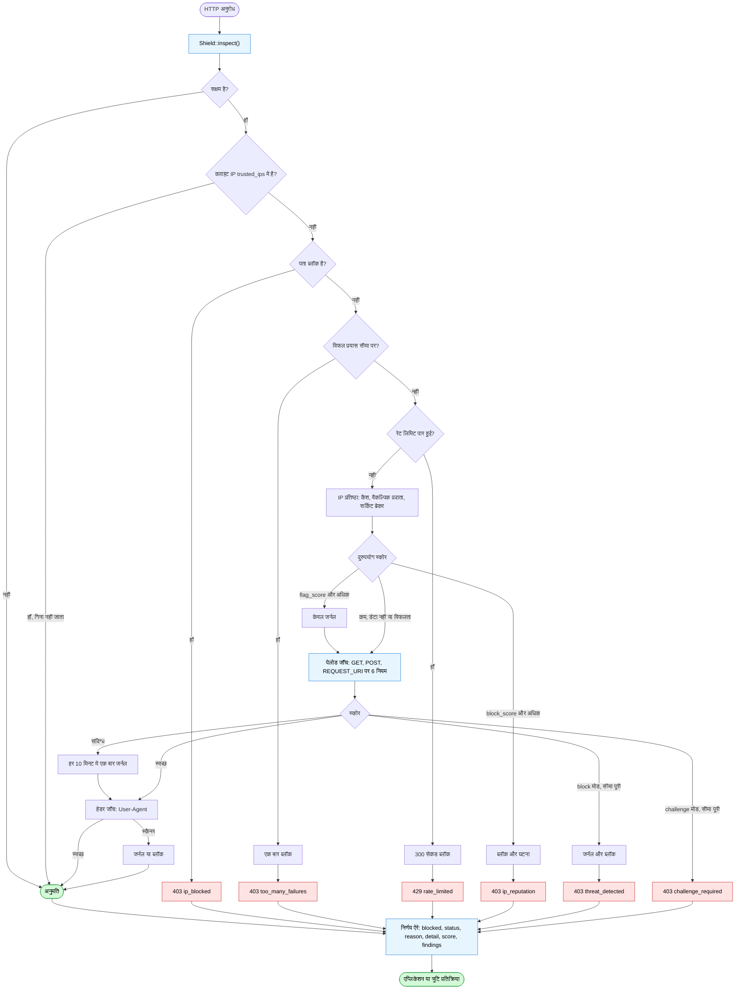

# PHP Shield

**PHP के लिए मॉड्यूलर रिक्वेस्ट फ़ायरवॉल**: लोकल थ्रेट डिटेक्शन, IPv4/IPv6 प्रतिष्ठा (AbuseIPDB.com और AbuseIPDB.ru), रेट लिमिटिंग, गंभीरता के आधार पर अवधि वाला IP ब्लॉकिंग, इंसिडेंट जर्नल और एडमिन डैशबोर्ड।

[English](README.md) · [Русский](README.ru.md) · [Deutsch](README.de.md) · [Español](README.es.md) · [中文](README.zh.md) · **हिन्दी**

[](https://github.com/paulmann/PHP-Shield/actions)
[](https://php.net)
[](phpstan.neon)
[](tests)
[](LICENSE)
[](https://github.com/paulmann/PHP-Shield/wiki)

## विषय-सूची

- [यह क्या करता है](#यह-क्या-करता-है)
- [अनुरोध पर निर्णय कैसे होता है](#अनुरोध-पर-निर्णय-कैसे-होता-है)
- [आवश्यकताएँ](#आवश्यकताएँ)
- [इंस्टॉल](#इंस्टॉल)
- [त्वरित शुरुआत](#त्वरित-शुरुआत)
- [निर्णय ऐरे](#निर्णय-ऐरे)
- [IP प्रतिष्ठा: AbuseIPDB.com और AbuseIPDB.ru](#ip-प्रतिष्ठा-abuseipdbcom-और-abuseipdbru)
- [डिटेक्शन नियम](#डिटेक्शन-नियम)
- [मोड और ब्लॉक की अवधि](#मोड-और-ब्लॉक-की-अवधि)
- [रेट लिमिटिंग](#रेट-लिमिटिंग)
- [स्टेट API](#स्टेट-api)
- [एडमिन डैशबोर्ड](#एडमिन-डैशबोर्ड)
- [रिवर्स प्रॉक्सी और क्लाइंट IP](#रिवर्स-प्रॉक्सी-और-क्लाइंट-ip)
- [आर्किटेक्चर](#आर्किटेक्चर)
- [परीक्षण](#परीक्षण)
- [प्रोडक्शन चेकलिस्ट](#प्रोडक्शन-चेकलिस्ट)
- [दस्तावेज़ीकरण](#दस्तावेज़ीकरण)
- [योगदान](#योगदान)
- [लाइसेंस](#लाइसेंस)
- [श्रेय](#श्रेय)

## यह क्या करता है

एक ही एंट्री पॉइंट, `Deynekin\PhpShield\Middleware\Shield::inspect()`, एक ही सवाल का जवाब देता है: **क्या यह रिक्वेस्ट आगे बढ़ सकती है, और अगर नहीं, तो क्यों?**

यह चार परतों को जोड़ता है:

| परत | क्लास | ज़िम्मेदारी |
|---|---|---|
| निर्णय | `Middleware\Shield` | रेट लिमिट, पेलोड/हेडर स्कैनिंग, IP प्रतिष्ठा, अंतिम फ़ैसला |
| स्टेट | `Middleware\SecurityMiddleware` | ब्लॉक, इंसिडेंट जर्नल, फेल्ड-अटेम्प्ट काउंटर, क्लीनअप, आँकड़े |
| डिटेक्शन | `Detection\*` | प्लगेबल नियम जो पेलोड को स्कोर देते हैं |
| ज्ञान (Knowledge) | `ThreatIntel\*` | AbuseIPDB.com / AbuseIPDB.ru प्रतिष्ठा, कैश और circuit breaker के साथ |

हर निर्णय दो नियमों से तय होता है:

- **एक अकेली फ़ाइंडिंग कभी किसी को बैन नहीं करती।** स्कोर जुड़ते रहते हैं और सिर्फ़ `block_threshold` से ऊपर का कुल स्कोर ही ब्लॉक करता है। परमानेंट ब्लॉक का फ़ैसला रेगुलर एक्सप्रेशन नहीं, ऑपरेटर करता है।
- **इंफ्रास्ट्रक्चर की गड़बड़ी पर कुछ भी fail-closed नहीं होता।** डेटाबेस या API का बंद होना "डेटा नहीं है" है, "मना कर दो" नहीं — देखें [ADR-006](docs/adr.md)।

यह शील्ड **क्या नहीं है**: prepared statements, आउटपुट एस्केपिंग, CSP, ऑथेंटिकेशन या सेशन सुरक्षा का विकल्प नहीं। यह समय और दृश्यता देता है; एप्लिकेशन के दोष ठीक नहीं करता।

## अनुरोध पर निर्णय कैसे होता है

`inspect()` परतों को एक निश्चित क्रम में देखता है: सस्ती जाँच पहले, नेटवर्क सबसे अंत में, और भरोसेमंद पता किसी भी काम से पहले बाहर निकल जाता है। हर शाखा अंत में वही निर्णय ऐरे देती है: `blocked`, `status`, `reason`, `detail`, `score` और `findings`।



मोड की शाखाएँ स्कोर के पास हैं, सबसे ऊपर नहीं: `monitor` और `challenge` किसी निष्कर्ष पर प्रतिक्रिया बदलते हैं, जाँचों का क्रम नहीं।

## आवश्यकताएँ

- PHP 8.1 – 8.5, `ext-json`, `ext-mbstring`
- वैकल्पिक: `ext-mysqli` (MySQL स्टोरेज, एडमिन), `ext-redis` (Redis रेट लिमिटर), `ext-curl` (IP प्रतिष्ठा)

## इंस्टॉल

```bash
composer require paulmann/php-shield
```

## त्वरित शुरुआत

```php
<?php
require 'vendor/autoload.php';

use Deynekin\PhpShield\ShieldFactory;

$config = require 'vendor/paulmann/php-shield/config/default.php';
$config['mode'] = 'monitor';              // start safe, switch to "block" after tuning

$mysqli = new mysqli('127.0.0.1', 'user', 'pass', 'dbname');
$shield = ShieldFactory::create($config, $mysqli);

$decision = $shield->inspect(array_merge($_GET, $_POST), $_SERVER, $_SERVER['REQUEST_URI'] ?? '/');

if ($decision['blocked']) {
    http_response_code($decision['status']);
    header('Content-Type: application/json');
    exit(json_encode(['error' => $decision['reason'], 'detail' => $decision['detail']]));
}

// Application logic continues...
```

MySQL नहीं है? तब शील्ड को कंपोनेंट्स से बनाइए — लोकल डिटेक्शन, हेडर और आँकड़े काम करते रहेंगे:

```php
$shield = ShieldFactory::createWithComponents(
    $blockStore,                                  // your BlockStoreInterface implementation
    new \Deynekin\PhpShield\RateLimiting\RedisRateLimiter($redis),
    $config
);
```

## निर्णय ऐरे

`inspect()` यह लौटाता है:

```php
[
    'blocked'  => true,                 // may the request proceed?
    'status'   => 403,                  // HTTP status to send
    'reason'   => 'threat_detected',    // machine-readable code
    'detail'   => '...',                // human-readable text
    'score'    => 90,                   // accumulated score
    'findings' => ['xss', 'sql_injection'],
]
```

कारण: `ip_blocked`, `too_many_failures`, `rate_limited`, `ip_reputation`, `threat_detected`, `challenge_required`, `suspicious_user_agent`.

जाँचों का क्रम निश्चित और जानबूझकर तय है: मास्टर स्विच → भरोसेमंद पता (कभी ब्लॉक नहीं, कभी गिना नहीं जाता) → सक्रिय ब्लॉक → फेल्ड-अटेम्प्ट काउंटर → रेट लिमिट → IP प्रतिष्ठा → पेलोड स्कैन → हेडर स्कैन → अनुमति।

अगर सिर्फ़ boolean चाहिए, तो वही आर्ग्युमेंट देकर `isRequestAllowed()` कॉल कीजिए।

# README i18n hi — run 78725121 participant 3

## IP reputation: AbuseIPDB.com and AbuseIPDB.ru

दोनों सेवाएँ एक ही API v2 contract (`/check`, `Key:` header, समान envelopes) लागू करती हैं, इसलिए एक ही client दोनों के लिए पर्याप्त है और checker उन्हें क्रम से आज़माता है।

Reputation परत **डिफ़ॉल्ट रूप से asynchronous** है: कोई भी request AbuseIPDB की प्रतीक्षा कभी नहीं करता। ज्ञात पता cache से उत्तर पाता है, अज्ञात पता एक ही `INSERT` के साथ queue में चला जाता है, और worker cache को पृष्ठभूमि में भर देता है। `'mode' => 'sync'` पर केवल कम-ट्रैफ़िक endpoints, tests या CLI tools के लिए जाएँ।

| मोड | अनुरोध पथ | निर्णय कब लागू होता है |
|---|---|---|
| `async` (डिफ़ॉल्ट) | cache read तथा अधिकतम एक `INSERT` `php_shield_reputation_queue` में | worker द्वारा उत्तर संग्रहीत करने के बाद अगले request से |
| `sync` | एक HTTP call, `timeout` द्वारा सीमित | तत्काल |

```bash
# cron: fill the reputation cache every minute
* * * * * php /path/to/PHP-Shield/tools/reputation-worker.php >> /var/log/php-shield-reputation.log 2>&1

php tools/reputation-worker.php --status         # queue size and providers
php tools/reputation-worker.php --ip=8.8.8.8     # one address now (debugging)
```

```php
$config['ip_reputation'] = [
    'enabled' => true,
    'block_score' => 75,   // abuseConfidenceScore that blocks
    'flag_score' => 25,    // score that is only journaled
    'cache_ttl' => 86400,
    'max_age_days' => 90,
    'timeout' => 2,        // sync mode only
    'queue_batch' => 50,   // addresses claimed per worker run
    'per_run' => 100,      // lookups per worker run (quota guard)
    'retry_after' => 300,  // retry delay after a failed lookup
    'providers' => [
        ['name' => 'abuseipdb.com', 'base_url' => 'https://api.abuseipdb.com/api/v2',
         'api_key' => null, 'api_key_env' => 'ABUSEIPDB_API_KEY'],
        ['name' => 'abuseipdb.ru',  'base_url' => 'https://abuseipdb.ru/api/v2',
         'api_key' => null, 'api_key_env' => 'ABUSEIPDB_RU_API_KEY'],
    ],
];
```

```bash
export ABUSEIPDB_API_KEY=[redacted]          # or put the key in the config, never in git
php tools/live-abuseipdb.php 8.8.8.8
```

प्रोडक्शन में महत्वपूर्ण व्यवहार:

- उत्तर `cache_ttl` सेकंड तक cache किए जाते हैं — एक burst पर केवल एक query खर्च होती है, और केवल public पतों के बारे में ही पूछा जाता है;
- worker `per_run` का पालन करता है, इसलिए दैनिक quota एक ही burst में खर्च होने के बजाय धीरे-धीरे खर्च होता है;
- असफल lookup `retry_after` backoff के साथ queue में बना रहता है — API बंद होने पर worker chक्कर नहीं खाता;
- किसी नए पते की पहली visit न कभी विलंबित होती है और न ही AbuseIPDB *के कारण* block होती है: reputation परत अगले request पर उसे confirm या clear करती है (ADR-010);
- जो पहला provider उत्तर देता है वही जीतता है; वह विफल हो तो अगला आज़माया जाता है;
- `429` को कभी in-process retry नहीं किया जाता: घोषित window का पालन आगे के सभी lookups के लिए होता है;
- `circuit_breaker.failures` लगातार त्रुटियों के बाद कोई provider `cooldown` सेकंड के लिए छोड़ दिया जाता है;
- `null` उत्तर, timeout या quota त्रुटि कभी किसी request को block नहीं करती;
- `monitor` मोड में उच्च score journal होता है, block नहीं होता।

## डिटेक्शन नियम

| नियम | श्रेणी | स्कोर | टिप्पणियाँ |
|---|---|---|---|
| `sql_injection` | इंजेक्शन | 25–80 | `UNION SELECT`, स्टैक्ड क्वेरी, `SLEEP`, टॉटोलॉजी |
| `xss` | xss | 40–90 | script/iframe/object टैग, इवेंट हैंडलर, `javascript:` |
| `command_injection` | इंजेक्शन | 60–85 | `system()` फ़ैमिली, कमांड में पाइप, कमांड बैकटिक |
| `path_traversal` | पाथ | 60–95 | बार-बार `../`, `/etc/passwd`, `.ssh`, `/proc/self` |
| `file_inclusion` | इन्क्लूज़न | 60–85 | रिमोट इन्क्लूड, `php://` रैपर |
| `suspicious_header` | हेडर | 60–70 | स्कैनर User-Agent (sqlmap, nikto, nmap, …) |

वैल्यू दो तरह से स्कैन होती हैं — जैसी मिली वैसी और URL डिकोडिंग के बाद — साथ ही रॉ `REQUEST_URI` भी, इसलिए `%3Cscript%3E` भी पकड़ा जाता है। प्रति नियम और प्रति फ़ील्ड एक ही फ़ाइंडिंग दर्ज होती है, इसलिए दो बार एनकोड किया गया पेलोड अपना स्कोर नहीं बढ़ा सकता।

### कस्टम नियम

```php
use Deynekin\PhpShield\Detection\AbstractRule;
use Deynekin\PhpShield\Detection\RuleFactory;

final class MyRule extends AbstractRule
{
    public function getName(): string { return 'my_rule'; }
    public function getCategory(): string { return 'custom'; }

    public function check(string $value, string $fieldName): array
    {
        return $this->match('/evil/i', $value, $fieldName, 45, 'Custom evil pattern');
    }
}

RuleFactory::register('my_rule', MyRule::class);
```

## मोड और ब्लॉक की अवधि

| मोड | व्यवहार |
|---|---|
| `monitor` | सब कुछ जर्नल होता है, कुछ भी ब्लॉक नहीं होता |
| `challenge` | गंभीर फ़ाइंडिंग 403 `challenge_required` के साथ अस्वीकार होती हैं और ब्लॉक नहीं होतीं |
| `block` | गंभीर फ़ाइंडिंग पते को गंभीरता से निकली अवधि के लिए ब्लॉक करती हैं |

अवधि = `block_duration` × `severity_block_multipliers`:

| गंभीरता | गुणक | डिफ़ॉल्ट अवधि |
|---|---|---|
| `low` | 0.5 | 30 मिनट |
| `medium` | 1 | 1 घंटा |
| `high` | 4 | 4 घंटे |
| `critical` | 12 | 12 घंटे |

रेट लिमिटिंग की अपनी छोटी विंडो है (`rate_limit_block_duration`, 300 सेकंड), ताकि साझा/NAT पते से आया बर्स्ट पूरे ऑफ़िस को बाहर न कर दे। परमानेंट ब्लॉक कभी अपने आप नहीं होता: वह डैशबोर्ड में ऑपरेटर की कार्रवाई है या `blockPermanently()`।

## रेट लिमिटिंग

| बैकएंड | गिनती कैसे होती है | कब इस्तेमाल करें |
|---|---|---|
| `DatabaseRateLimiter` | `php_shield_rate_limit` पर दो स्टेटमेंट (काउंट, इंसर्ट) | कम और मध्यम ट्रैफ़िक; `prune()` को शेड्यूल पर कॉल कीजिए |
| `RedisRateLimiter` | एटॉमिक `INCR` + `EXPIRE` | समवर्ती ट्रैफ़िक; Redis न मिले तो fail-open होता है और लॉग लिखता है |

डिफ़ॉल्ट सीमाएँ प्रति पता और एंडपॉइंट 60/मिनट, 1 000/घंटा और 10 000/दिन हैं। दोनों बैकएंड `RateLimiterInterface` लागू करते हैं, इसलिए मौजूदा लिमिटर भी जोड़ा जा सकता है।

## स्टेट API

```php
$state = $shield->middleware();

$state->isIpBlocked('203.0.113.5');
$state->blockIp('203.0.113.5', 'scanner', SecurityMiddleware::SEVERITY_HIGH);
$state->blockPermanently('203.0.113.5', 'manual decision');   // operator only
$state->unblockIp('203.0.113.5');

$state->recordFailedAttempt('203.0.113.5');   // e.g. from your login handler
$state->failedAttempts('203.0.113.5');
$state->clearFailedAttempts('203.0.113.5');

$state->recordIncident('203.0.113.5', 'login_bruteforce', 'Ten failed logins', 'high');
$state->recentIncidentCount('203.0.113.5', 600);
$state->activeBlocks(50);
$state->stats();
$state->cleanup(30);        // retention: expired blocks, old incidents, stale counters
```

जब फेल्ड-अटेम्प्ट काउंटर `max_failed_attempts` (25) तक पहुँचता है, तो उस पते से अगली रिक्वेस्ट एक बार ब्लॉक होती है और काउंटर साफ़ कर दिया जाता है।

टेबल: `php_shield_ip_blocks`, `php_shield_incidents`, `php_shield_failed_attempts`, `php_shield_rate_limit`, `php_shield_ip_reputation`. सभी एक्सपायरी डेटाबेस ही गिनता है (`NOW()`, `DATE_ADD`), इसलिए PHP और MySQL के टाइम ज़ोन का फ़र्क़ ताज़ा ब्लॉक को एक्सपायर नहीं कर सकता।

## एडमिन डैशबोर्ड

`public/admin/index.php` — आँकड़े, सक्रिय ब्लॉक, मैन्युअल ब्लॉक/अनब्लॉक, मास्क किया गया कॉन्फ़िगरेशन।

- हर स्टेट बदलने वाले फ़ॉर्म में प्रति-सेशन anti-CSRF टोकन होता है;
- लॉगिन रेट-लिमिटेड है (5 फेल → 5 मिनट लॉकआउट), लॉगिन पर सेशन आईडी फिर से बनाई जाती है;
- सेशन कुकी `HttpOnly`, `SameSite=Strict` और HTTPS पर `Secure` होती है;
- कॉन्फ़िगरेशन डंप रेंडर होने से पहले पासवर्ड, टोकन और कीज़ को मास्क कर देता है।

हैश बनाइए और एंडपॉइंट को वेब सर्वर स्तर पर भी सुरक्षित कीजिए:

```bash
php -r "echo password_hash('your-secret', PASSWORD_DEFAULT), PHP_EOL;"
```

## रिवर्स प्रॉक्सी और क्लाइंट IP

`X-Forwarded-For` पर तभी भरोसा किया जाता है जब `REMOTE_ADDR` `trusted_proxies` में हो, और चेन **दाएँ से बाएँ** पढ़ी जाती है, भरोसेमंद हॉप छोड़ते हुए:

```text
X-Forwarded-For: 1.2.3.4, 203.0.113.9      (client-supplied, added by nginx)
REMOTE_ADDR:     10.0.0.5                  (trusted proxy)
→ client = 203.0.113.9
```

इसके बजाय सबसे बाएँ वाली एंट्री पढ़ने पर कोई भी क्लाइंट अपना पता खुद चुन सकता — और अगर उससे मेल खाती `trusted_ips` एंट्री हो, तो पूरी शील्ड बायपास कर सकता। यह वास्तविक दोष था, 2.0.0 में ठीक हुआ और [security review](docs/security-review.md) में दर्ज है।

## आर्किटेक्चर

```text
src/
├── ShieldFactory.php              ← wiring from configuration
├── Middleware/
│   ├── Shield.php                 ← decision: inspect() / isRequestAllowed()
│   └── SecurityMiddleware.php     ← state: blocks, incidents, counters, cleanup
├── Detection/                     ← rules + registry
├── ThreatIntel/                   ← AbuseIPDB.com / .ru, cache, circuit breaker
├── Ip/                            ← safe client IP resolution, CIDR
├── RateLimiting/                  ← database + Redis limiters
├── Storage/                       ← block store interfaces + MySQL
├── Admin/                         ← dashboard logic, sessions, CSRF
├── Support/                       ← typed config, redaction, headers
└── Exception/
```

डिज़ाइन निर्णय, विकल्प और उनके परिणाम [docs/adr.md](docs/adr.md) में दर्ज हैं।

## परीक्षण

```bash
composer test          # PHPUnit, 120 tests, no database needed
composer phpstan       # level max, zero errors
composer cs-check      # coding standard

# real MySQL (creates its own tables, never drops a database)
MYSQL_PWD=... php -d extension=mysqli tools/db-selftest.php php_shield_test

# live AbuseIPDB check (key from the environment)
ABUSEIPDB_API_KEY=[redacted] php tools/live-abuseipdb.php 8.8.8.8
```

CI, PHP 8.1 – 8.5 पर PHPUnit, PHPStan level max, कोडिंग स्टैंडर्ड और हर PHP फ़ाइल का सिंटैक्स चेक चलाता है।

## प्रोडक्शन चेकलिस्ट

1. कुछ दिनों तक `monitor` मोड में चलाइए।
2. `php_shield_incidents` पढ़िए और `block_threshold` ट्यून कीजिए / शोर मचाने वाले नियम बंद कीजिए।
3. `migrations/schema.sql` लगाइए और `auto_migrate` को `false` कर दीजिए।
4. समवर्ती ट्रैफ़िक के लिए रेट लिमिटर को Redis पर बदलिए।
5. अगर आप रिवर्स प्रॉक्सी के पीछे हैं तो `trusted_proxies` भरिए — फ़ॉरवर्डेड हेडर **केवल** उन्हीं पतों से माने जाते हैं, और चेन दाएँ से बाएँ पढ़ी जाती है।
6. एडमिन डैशबोर्ड सुरक्षित कीजिए; मज़बूत पासवर्ड हैश सेट कीजिए।
7. `cleanup()` (रिटेंशन) और `DatabaseRateLimiter::prune()` को शेड्यूल कीजिए।
8. AbuseIPDB.com के साथ `ip_reputation` चालू कीजिए, AbuseIPDB.ru को फ़ॉलबैक रखिए।
9. रिक्वेस्ट के शुरू में ही `SecurityHeaders::send()` जोड़िए।
10. `block` मोड पर जाइए और एक दिन 403/429 की दर देखिए।

## दस्तावेज़ीकरण

- [Wiki](https://github.com/paulmann/PHP-Shield/wiki) — कॉन्फ़िगरेशन संदर्भ, रेसिपी, समस्या-निवारण, अपग्रेड गाइड
- [Architecture Decision Records](docs/adr.md)
- [Security review](docs/security-review.md) — फ़ाइंडिंग और उनके फ़िक्स
- [Reference adapter](integration/abuseipdb-ru/README.md) — हाथ से लिखे AbuseIPDB.RU middleware को इस पैकेज से बदलना
- [SECURITY.md](SECURITY.md) — कमज़ोरी की रिपोर्ट कैसे करें
- [AGENTS.md](AGENTS.md) — AI कोडिंग एजेंट के लिए निर्देश

## योगदान

पहले [CONTRIBUTING.md](CONTRIBUTING.md) पढ़िए: कोडिंग स्टैंडर्ड, स्टैटिक विश्लेषण, टेस्ट और रिव्यू चेकलिस्ट। Issue और pull request का स्वागत है; सुरक्षा रिपोर्ट [SECURITY.md](SECURITY.md) के रास्ते भेजिए।

## लाइसेंस

MIT — देखें [LICENSE](LICENSE)।

## श्रेय

Mikhail Deynekin द्वारा बनाया गया। गंभीरता नीति और state/detection का बँटवारा AbuseIPDB.RU पर इस्तेमाल हुए स्टैंड-अलोन middleware और PHP-Form-Spam-Checker के WAF से आकार लिया।

---

[English](README.md) · [Русский](README.ru.md) · [Deutsch](README.de.md) · [Español](README.es.md) · [中文](README.zh.md) · **हिन्दी**
