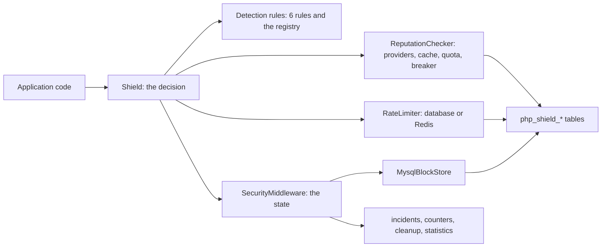
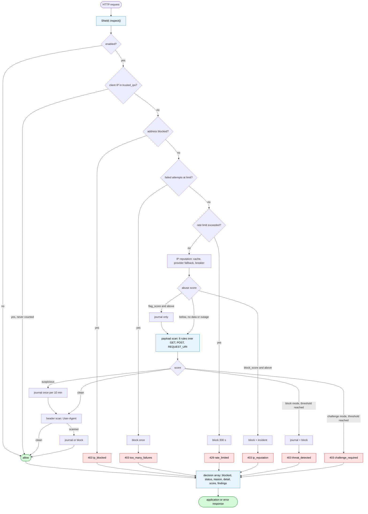

# Architecture

## Four layers, two classes with a job each

```text
src/
├── ShieldFactory.php              ← wiring from configuration
├── Middleware/
│   ├── Shield.php                 ← decision: inspect() / isRequestAllowed()
│   └── SecurityMiddleware.php     ← state: blocks, incidents, counters, cleanup
├── Detection/                     ← rules + registry
├── ThreatIntel/                   ← AbuseIPDB.com / .ru, cache, circuit breaker
├── Ip/                            ← safe client IP resolution, CIDR
├── RateLimiting/                  ← database + Redis limiters
├── Storage/                       ← block store interfaces + MySQL
├── Admin/                         ← dashboard logic, sessions, CSRF
├── Support/                       ← typed config, redaction, headers
└── Exception/
```

| Layer | Class | Owns | Must not |
|---|---|---|---|
| Decision | `Middleware\Shield` | rate limits, payload and header scanning, reputation, the verdict | write to storage directly |
| State | `Middleware\SecurityMiddleware` | blocks, incident journal, failed-attempt counters, cleanup, statistics | detect anything |
| Detection | `Detection\*` | scoring a value, one rule per concern | know about storage |
| Knowledge | `ThreatIntel\*` | a provider answer, the cache, the breaker | block a request |



## The decisions behind the shape

| ADR | Decision | Consequence |
|---|---|---|
| [001](https://github.com/paulmann/PHP-Shield/blob/main/docs/adr.md) | each detection category is a class implementing `RuleInterface`, built by `RuleFactory` | rules are testable in isolation, projects register their own without forking |
| 002 | scores accumulate, only a total above `block_threshold` blocks | no regex can ban a customer forever; permanent blocks are an operator action |
| 003 | forwarded headers are read right to left, only from `trusted_proxies` | no client-chosen address, no silent bypass |
| 004 | `BlockStoreInterface` and `RateLimiterInterface` are the only storage contracts | MySQL is one implementation; tests need no services |
| 005 | detection and state are separate classes | one source of truth each; the state API works from a login handler or a CLI |
| 006 | infrastructure failures fail open and log | a database or API outage is not a site outage |
| 007 | one client for both AbuseIPDB communities | `.com`, `.ru` or both, in a configured order, verified by contract tests |
| 008 | cache, quota window and circuit breaker sit in front of `/check` | a burst costs one query, a broken provider costs nothing |
| 009 | every expiry is computed in SQL | the library is time-zone agnostic; `date()` is forbidden in stored comparisons |

The full text, with alternatives and rejected options, is in
[docs/adr.md](https://github.com/paulmann/PHP-Shield/blob/main/docs/adr.md).

## Request flow



The order is the design: cheap checks first, network last, and a trusted address exits before any work
is done.

## Extension points

| You want | Implement | Wire it with |
|---|---|---|
| a detection rule | `Detection\AbstractRule` | `RuleFactory::register()`, then `enabled_rules` |
| a reputation provider | `ThreatIntel\ReputationProviderInterface` | `ShieldFactory::buildProviders()` |
| a storage backend | `Storage\BlockStoreInterface` (+ optional capability interfaces) | `ShieldFactory::createWithComponents()` |
| a rate limiter | `RateLimiting\RateLimiterInterface` | `ShieldFactory::createWithComponents()` |
| a different client IP policy | `Ip\IpResolver` | `createWithComponents(..., ipResolver: ...)` |

## What is deliberately absent

- plugins, events and a container: this library runs inside someone else's request path and must stay
  predictable;
- a queue or a background worker: cleanup is a scheduled call, not a daemon;
- a second storage engine for its own sake: MySQL and Redis cover the deployment shapes this project
  targets, and the interfaces leave the rest to the application.
