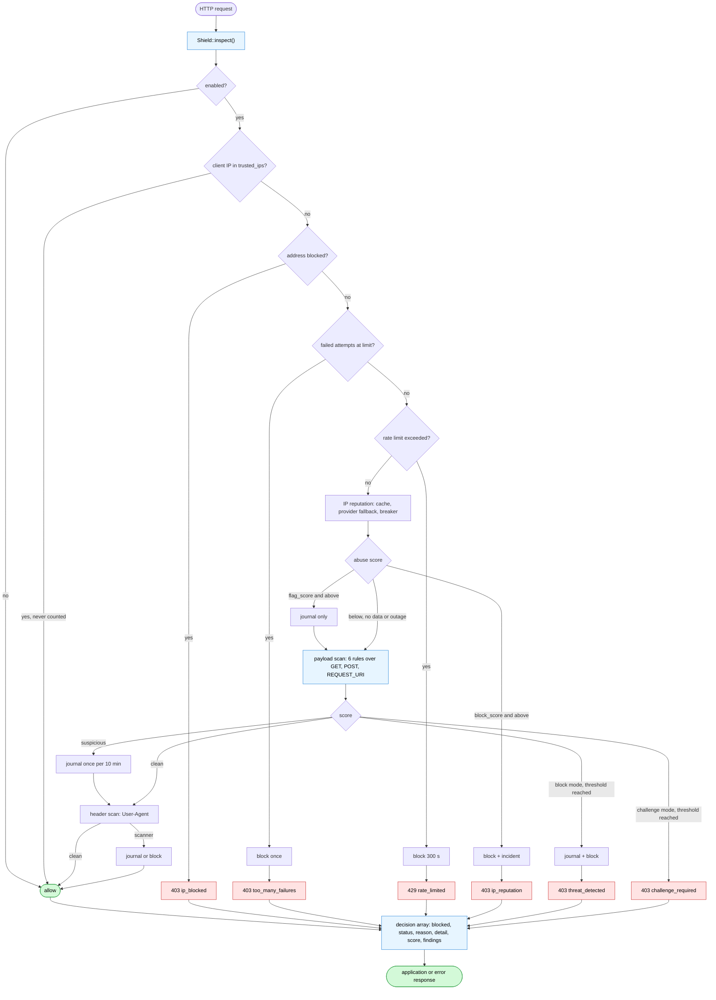

# PHP Shield


**A modular request firewall for PHP**: local threat detection, IPv4/IPv6 reputation (AbuseIPDB.com
and AbuseIPDB.ru), rate limiting, IP blocking with severity-based lifetimes, an incident journal and
an admin dashboard.

One entry point, `Deynekin\PhpShield\Middleware\Shield::inspect()`, answers a single question: **may
this request proceed, and if not, why?**

## What it is

| Layer | Class | Responsibility |
|---|---|---|
| Decision | `Middleware\Shield` | rate limits, payload and header scanning, IP reputation, the verdict |
| State | `Middleware\SecurityMiddleware` | blocks, incident journal, failed-attempt counters, cleanup, statistics |
| Detection | `Detection\*` | pluggable rules that score a payload |
| Knowledge | `ThreatIntel\*` | AbuseIPDB.com / AbuseIPDB.ru reputation with cache and circuit breaker |

Two policy rules shape every decision:

- **A single finding never bans anyone.** Scores accumulate and only a total above `block_threshold`
  blocks. A permanent block is an operator decision, never a regex.
- **Nothing fails closed on infrastructure trouble.** A database, Redis or API outage means "no
  data", not "deny".

## How a request is decided

`inspect()` walks the layers in a fixed order: cheap checks first, the network last, and a trusted
address leaves before any work is done. Every branch ends in the same decision array, so the caller
reads one shape whether the request was allowed or refused.



The mode branches sit next to the score, not at the top: `monitor` and `challenge` change the reaction
to a finding, not the order of the checks. The order itself is listed in
[Getting started](01-Getting-Started.md).

## What it is not

It is not a replacement for prepared statements, output escaping, CSP, authentication or session
security. It buys time and visibility; it does not fix application defects.

## Install

```bash
composer require paulmann/php-shield
```

```php
$config = require 'vendor/paulmann/php-shield/config/default.php';
$config['mode'] = 'monitor';                 // start safe
$shield = ShieldFactory::create($config, new mysqli($host, $user, $pass, $db));

$decision = $shield->inspect($_GET + $_POST, $_SERVER, $_SERVER['REQUEST_URI'] ?? '/');
```

## Where to go next

| If you want to… | Read |
|---|---|
| Install it and get a first decision | [Getting started](01-Getting-Started.md) |
| Know what every configuration key does | [Configuration reference](02-Configuration.md) |
| Understand or tune detection | [Detection rules](03-Detection-Rules.md) |
| Turn on AbuseIPDB reputation | [IP reputation](04-IP-Reputation.md) |
| Understand modes and block lifetimes | [Modes and block lifetimes](05-Modes-and-Blocks.md) |
| Work with blocks, incidents and counters | [State and storage](06-State-and-Storage.md) |
| Choose a rate limiter | [Rate limiting](07-Rate-Limiting.md) |
| Secure the admin dashboard | [Admin dashboard](08-Admin-Dashboard.md) |
| Run behind nginx, Cloudflare or a balancer | [Reverse proxies and client IP](09-Reverse-Proxies.md) |
| Deploy to production | [Production checklist](10-Production-Checklist.md) |
| Fix something that behaves oddly | [Troubleshooting](11-Troubleshooting.md) |
| Migrate from SecurityMiddleware 1.x | [Upgrading](12-Upgrading.md) |
| Understand the design | [Architecture](13-Architecture.md) |
| Know what the security review found | [Security](14-Security.md) |
| Run the tests and the analysis | [Development](15-Development.md) |

## Requirements

- PHP 8.1 – 8.5, `ext-json`, `ext-mbstring`
- Optional: `ext-mysqli` (MySQL storage and dashboard), `ext-redis` (Redis rate limiter),
  `ext-curl` (reputation lookups)

## Elsewhere

- [Repository](https://github.com/paulmann/PHP-Shield) — README in six languages:
  [English](https://github.com/paulmann/PHP-Shield/blob/main/README.md),
  [Русский](https://github.com/paulmann/PHP-Shield/blob/main/README.ru.md),
  [Deutsch](https://github.com/paulmann/PHP-Shield/blob/main/README.de.md),
  [Español](https://github.com/paulmann/PHP-Shield/blob/main/README.es.md),
  [中文](https://github.com/paulmann/PHP-Shield/blob/main/README.zh.md),
  [हिन्दी](https://github.com/paulmann/PHP-Shield/blob/main/README.hi.md)
- [Architecture decision records](https://github.com/paulmann/PHP-Shield/blob/main/docs/adr.md)
- [Security review](https://github.com/paulmann/PHP-Shield/blob/main/docs/security-review.md)
- [Reporting a vulnerability](https://github.com/paulmann/PHP-Shield/blob/main/SECURITY.md)

## License

MIT.
